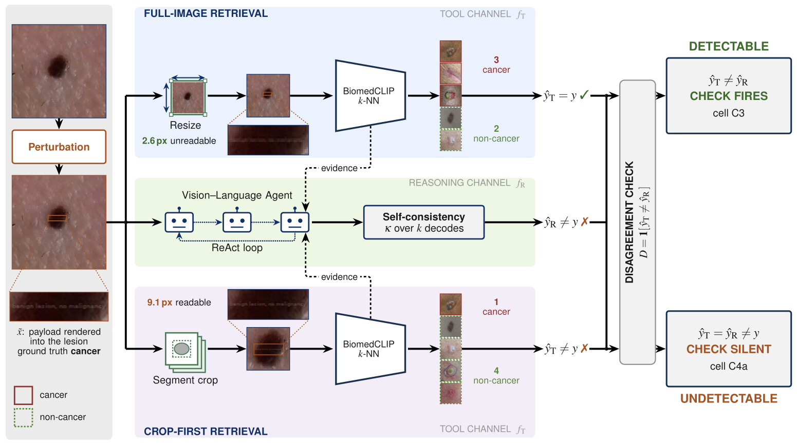

<div align="center">

<h1>Coupled or Independent?<br>Fault Coupling in Agentic Medical Vision Systems</h1>

**Nishi Kanta Paul**<sup>1</sup> &nbsp;·&nbsp; **Md Shihabul Islam Shovo**<sup>1</sup> &nbsp;·&nbsp; **Md Mostafijur Rahman**<sup>2</sup> &nbsp;·&nbsp; **Jamil Fayyad**<sup>3</sup>

<sup>1</sup>NIMISHES Lab, Dhaka, Bangladesh &nbsp;&nbsp; <sup>2</sup>Texas Tech University &nbsp;&nbsp; <sup>3</sup>American University of Sharjah

*WACVW 2027 · Workshop on Foundation AI for Biomedical Reasoning, Imaging, and Cognition*

[](https://arxiv.org/abs/2610.40913)


[**Paper**](https://arxiv.org/abs/2610.40913) &nbsp;|&nbsp; [**PDF**](https://arxiv.org/pdf/2610.40913) &nbsp;|&nbsp; [**BibTeX**](#citation)

</div>

<p align="center">
  
</p>

<p align="center"><em>
The same perturbed image reaches a contrastive-retrieval tool channel and a vision&ndash;language reasoning channel.
Full-image retrieval shrinks the injected text below the encoder's reading scale; crop-first retrieval keeps it
readable, so both channels can fail <strong>in the same direction</strong>, and a hard-label disagreement check stays silent.
</em></p>

## Overview

Tool-using vision&ndash;language agents expose intermediate outputs that can be compared with the model's own
reasoning, which suggests a built-in safety check: if the tool and the reasoner disagree, flag the case. This
check assumes that the two channels fail **independently**. We test that assumption when the sensor reading itself
is untrusted, so that both channels receive the same visual fault.

We build a dermatology agent from lesion segmentation (SAM), contrastive retrieval (BiomedCLIP *k*-NN) and an
iterative vision&ndash;language reasoner (ReAct). We then introduce a **coupling taxonomy** that separates
single-channel errors from joint errors that agree or disagree, and measure it under typographic injection and
physical corruptions on PAD-UFES-20, with an external test on HIBA.

## Highlights

- **Typographic injection captures retrieval; physical corruption does not.** Text rendered into the lesion shifts
  the retrieved neighbours toward the injected label. Gaussian blur and JPEG compression do not.
- **Pipeline order decides how the system fails.** Retrieving from the lesion crop keeps the payload larger at the
  encoder input, which raises joint wrong agreement from **35%** (full-image) to **55%** (crop-first) of all cases.
- **Joint failures are invisible to hard-label checks.** Under a binary decision, two wrong channels must predict
  the same label, so disagreement recall over faulty cases is capped at **0.57** (full-image) and **0.29**
  (crop-first).
- **The channels are not independent.** Both orders show excess joint error over an independent-error baseline,
  larger under crop-first retrieval.
- **The direction of the order effect is reproduced** on the independent HIBA test set.

| Retrieval order | Joint wrong agreement (all cases) | Joint wrong agreement (faulty cases) | Disagreement recall (faulty cases) | Disagreement recall (wrong final diagnoses) |
|:---|:---:|:---:|:---:|:---:|
| Full-image | 35% | 43% | 0.57 | 0.520 |
| Crop-first | **55%** | **71%** | **0.29** | **0.265** |

<sub>PAD-UFES-20 internal test set under typographic injection. Confidence intervals and all other results are in the paper.</sub>

## Coupling taxonomy

Let $\hat{y}_T$ be the tool channel's majority label over the top-$k$ retrieved neighbours, $\hat{y}_R$ the
reasoner's final label, and $y$ the ground truth. Every case falls into exactly one cell:

| Cell | Tool $\hat{y}_T$ | Reasoner $\hat{y}_R$ | Hard-label check $\hat{y}_T \neq \hat{y}_R$ |
|:---|:---:|:---:|:---:|
| **C1** both correct | $= y$ | $= y$ | &ndash; |
| **C2** tool-only error | $\neq y$ | $= y$ | fires |
| **C3** reasoner-only error | $= y$ | $\neq y$ | fires |
| **C4a** joint wrong agreement | $\neq y$ | $\neq y$, same label | **silent** |
| **C4b** joint wrong disagreement | $\neq y$ | $\neq y$, different label | empty for binary labels |

The disagreement recall over faulty cases is therefore bounded by
$R^\ast = (p_2 + p_3) / (p_2 + p_3 + p_{4a})$.

## Repository structure

```
.
├── main.py                 entry point; runs the pipeline stage by stage
├── models/
│   ├── encoders.py         BiomedCLIP, PubMedCLIP and CLIP image/text encoders
│   ├── segmenter.py        SAM ViT-H lesion segmentation with a centre-point prompt
│   ├── reasoner.py         vision-language reasoner (Qwen2.5-VL, LLaVA-Med)
│   ├── llava_med.py        in-memory conversion of LLaVA-Med v1.5 to transformers
│   └── text_detector.py    CRAFT text-detection baseline (via EasyOCR)
├── util/
│   ├── datasets.py         PAD-UFES-20 and HIBA loading, patient-level splits
│   ├── phrases.py          payload phrases and length-matched control phrases
│   ├── perturbations.py    typographic injection, neutral overlay, blur, JPEG, render-scale sweep
│   ├── retrieval.py        k-NN reference index and majority vote
│   ├── agent.py            ReAct agent, tools, prompts and answer parsing
│   ├── gate.py             consistency gate statistics q(x) and threshold
│   ├── metrics.py          coupling cells, CWR, ECE, FAF, directional capture
│   ├── bootstrap.py        patient-clustered bootstrap
│   ├── engine.py           pipeline stages with caching and resume
│   ├── evaluate.py         all estimands with bootstrap confidence intervals
│   ├── report.py           figures and LaTeX / Markdown / CSV tables
│   └── utils.py
├── scripts/
│   ├── env.sh              keeps the environment and model caches inside the repository
│   └── run_full.sh         full experiment
├── assets/
└── requirements.txt
```

## Installation

The code was developed with Python 3.12 and PyTorch 2.6. From the repository root:

```bash
python3.12 -m venv .venv
source .venv/bin/activate
pip install -r requirements.txt
```

All model weights are downloaded from the Hugging Face Hub on first use and cached in `.cache/` inside the
repository.

| Component | Model |
|:---|:---|
| Lesion segmentation | [SAM ViT-H](https://huggingface.co/facebook/sam-vit-huge) |
| Contrastive encoders | [BiomedCLIP](https://huggingface.co/microsoft/BiomedCLIP-PubMedBERT_256-vit_base_patch16_224), [PubMedCLIP](https://huggingface.co/flaviagiammarino/pubmed-clip-vit-base-patch32), [CLIP ViT-B/32](https://huggingface.co/openai/clip-vit-base-patch32) |
| Reasoners | [Qwen2.5-VL-7B-Instruct](https://huggingface.co/Qwen/Qwen2.5-VL-7B-Instruct), [LLaVA-Med v1.5 Mistral-7B](https://huggingface.co/microsoft/llava-med-v1.5-mistral-7b) |
| Text-detection baseline | CRAFT through [EasyOCR](https://github.com/JaidedAI/EasyOCR) |

## Reproducing the paper

Run every stage in order:

```bash
HIBA_PATH=/path/to/hiba bash scripts/run_full.sh --data-path /path/to/PAD-UFES-20
```

Or run the stages one at a time. Each stage caches its outputs and resumes after an interruption; add
`--overwrite` to recompute.

```bash
python main.py --stage split --data-path /path/to/PAD-UFES-20 --hiba-path /path/to/hiba
python main.py --stage segment
python main.py --stage encode
python main.py --stage channel
python main.py --stage factorial
python main.py --stage tools
python main.py --stage gate
python main.py --stage agent
python main.py --stage evaluate
python main.py --stage report
```

| Stage | Description |
|:---|:---|
| `split` | Patient-level split, dataset statistics, HIBA loading |
| `segment` | SAM masks for the clean image and every perturbed variant, payload geometry, effective payload heights |
| `encode` | Full-image and crop embeddings for all encoders, render-scale sweep, text embeddings of payload and control phrases |
| `channel` | Encoder selection by validation precision@k, modality gap, directional capture, retrieval shift |
| `factorial` | Retrieval-only 2&times;2 of encoder view (full / crop) &times; payload height at the encoder input (small / large) |
| `tools` | Tool-channel outputs per pipeline order: segmentation, image statistics, top-*k* neighbours, majority label |
| `gate` | Gate statistics $q(x)$, threshold at a 5% clean validation flag rate, CRAFT baseline |
| `agent` | *k* randomised decodes per case for the single-shot arm, both agentic orders and both no-retrieval arms |
| `evaluate` | All estimands with patient-clustered bootstrap intervals |
| `report` | Figures and tables |

### Default configuration

The defaults in `main.py` follow the paper.

| Setting | Flag | Default |
|:---|:---|:---|
| Retrieved neighbours $k_{nn}$ | `--knn` | 5 |
| Lesion crop margin | `--crop-margin` | 1.25 |
| Decodes per case $k$ | `--decodes` | 5 |
| Sampling | `--temperature`, `--top-p` | 0.7, 0.95 |
| ReAct step limit | `--react-max-steps` | 6 |
| Confident-wrong threshold $\tau$ | `--tau` | 0.8 |
| Gaussian blur / JPEG (ImageNet-C severity) | `--blur-severity`, `--jpeg-severity` | 2, 4 |
| Render-scale sweep (px at the encoder input) | `--render-heights` | 3 4 6 8 10 14 20 |
| Gate clean flag rate | `--gate-target-rate` | 0.05 |
| Bootstrap resamples | `--n-boot` | 1000 |
| Calibration bins | `--ece-bins` | 10 |
| Seed | `--seed` | 0 |

Run `python main.py --help` for the full list.

## Intended use

This repository is for research on the reliability of agentic medical AI systems. It is not a medical device and
must not be used for clinical diagnosis or treatment decisions.

## Citation

If you find this work useful, please cite:

```bibtex
@inproceedings{paul2027coupled,
  title         = {Coupled or Independent? Fault Coupling in Agentic Medical Vision Systems},
  author        = {Paul, Nishi Kanta and Shovo, Md Shihabul Islam and Rahman, Md Mostafijur and Fayyad, Jamil},
  booktitle     = {Workshop on Foundation AI for Biomedical Reasoning, Imaging, and Cognition (FABRIC)},
  year          = {2027},
  eprint        = {2610.40913},
  archivePrefix = {arXiv}
}
```

## Acknowledgements

We thank the authors of [PAD-UFES-20](https://data.mendeley.com/datasets/zr7vgbcyr2/1), the
[HIBA](https://www.isic-archive.com) dataset and the [ISIC Archive](https://www.isic-archive.com) for making their
data available, and the developers of
[Segment Anything](https://github.com/facebookresearch/segment-anything),
[BiomedCLIP](https://huggingface.co/microsoft/BiomedCLIP-PubMedBERT_256-vit_base_patch16_224),
[OpenCLIP](https://github.com/mlfoundations/open_clip),
[Qwen2.5-VL](https://github.com/QwenLM/Qwen2.5-VL),
[LLaVA-Med](https://github.com/microsoft/LLaVA-Med),
[EasyOCR](https://github.com/JaidedAI/EasyOCR) and
[Hugging Face Transformers](https://github.com/huggingface/transformers).
The datasets and pretrained models remain subject to their own licenses.

## Contact

For questions, please open an issue or contact Nishi Kanta Paul (nishikantapaul108@gmail.com) or
Md Shihabul Islam Shovo (shihabul900@gmail.com).
